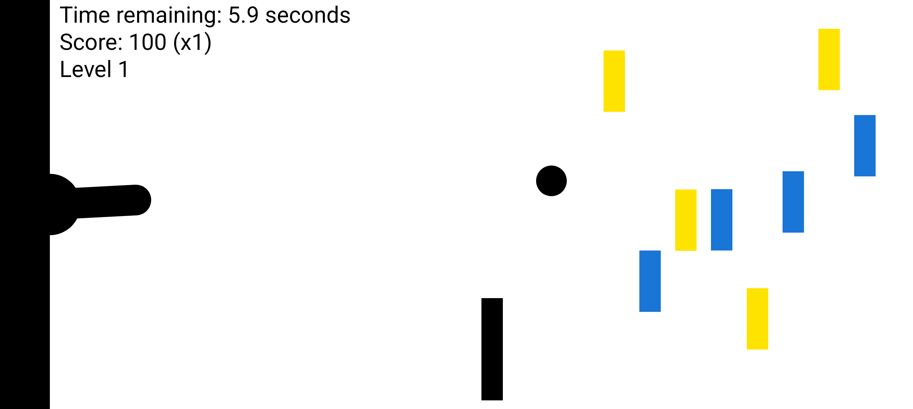
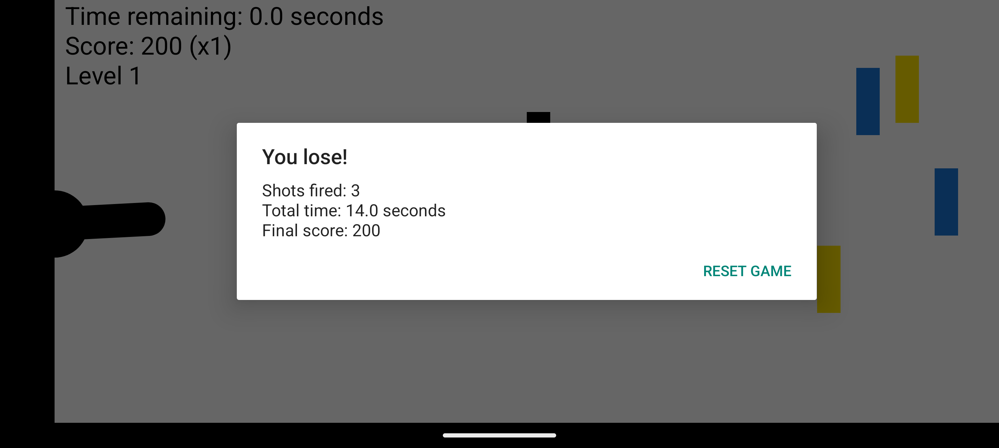

# Cannon Game 🎯

Repositório do trabalho da disciplina **Programação III** — aplicação
**Cannon Game** do Capítulo 6 de *Android 6 for Programmers: An App-Driven
Approach (3rd Edition)*, com recursos extras (bônus).

## Integrantes

| Nome | GitHub |
|------|--------|
| Alvaro Silva Guimaraes Santos | [@alvarossantos](https://github.com/alvarossantos) |

## Objetivo

Desenvolver a aplicação completa **Cannon Game**, demonstrando domínio prático
dos conceitos fundamentais de programação mobile em Android:

- Animação quadro a quadro (*frame-by-frame animation*) manual;
- Manipulação gráfica com `Canvas` e `Paint`;
- Execução de sons com `SoundPool` e `AudioManager`;
- Controle de *threads* para lógica de jogo e **game loop**;
- Uso de `SurfaceView` e `SurfaceHolder`;
- Modo imersivo e controle de tela cheia;
- Interatividade por toque (`onTouchEvent`) e atualização responsiva da tela.

## Como jogar

Toque na tela para **mirar e disparar** o canhão na direção do ponto tocado.
Só existe um projétil em cena por vez. Destrua os **9 alvos** antes que o
tempo acabe:

- **Acerto no alvo:** +3 segundos e pontos;
- **Acerto no bloqueador:** −2 segundos, o projétil quica e o multiplicador
  de pontos é zerado;
- **Tempo zerado:** derrota; **9 alvos destruídos:** vitória.

Ao final do jogo é exibido um diálogo com o resultado, tiros disparados,
tempo total e a pontuação final, com o botão **Reset Game** para recomeçar.

## Recursos implementados

### Requisitos do Capítulo 6

- [x] `CannonView` (subclasse de `SurfaceView`) com `SurfaceHolder.Callback`
- [x] Game loop em thread própria (`CannonThread`) com delta-time entre frames
- [x] Desenho de canhão, projétil, bloqueador e alvos com `Canvas`/`Paint`
- [x] Detecção de colisão simples (`Rect.intersects`) com quique no bloqueador
- [x] Sons em `res/raw` (`cannon_fire`, `target_hit`, `blocker_hit`) via `SoundPool`
- [x] Controle de volume pelos botões do aparelho (`AudioManager.STREAM_MUSIC`)
- [x] Eventos de toque em `onTouchEvent` (alvo + disparo)
- [x] Modo imersivo / tela cheia (`SYSTEM_UI_FLAG_IMMERSIVE` + tema sem app bar)
- [x] Ciclo de vida do `Fragment` (`onPause` encerra o loop, `onDestroy` libera recursos)
- [x] Orientação *landscape* e organização em classes (`MainActivity`,
      `MainActivityFragment`, `GameElement`, `Blocker`, `Target`, `Cannon`,
      `Cannonball`, `CannonView`)

### Recursos extras (bônus)

- [x] **Sistema de pontuação com multiplicadores** — 100 pontos por alvo,
      multiplicador cresce a cada acerto consecutivo (até x5) e zera ao acertar
      o bloqueador; HUD atualizado em tempo real.
- [x] **Dificuldade progressiva (níveis)** — a cada 3 alvos destruídos o nível
      sobe: bloqueador e alvos restantes aceleram e os alvos encolhem.
- [x] **Partículas ao acertar o alvo** — explosão de faíscas com movimento
      radial, atrito e *fade out* animados quadro a quadro.

## Screenshots

| Gameplay | Fim de jogo |
|----------|-------------|
|  |  |

> Capturas executadas no emulador Android (API 37, modo imersivo ativo).

## Como executar

### Opção 1 — Android Studio

1. `File > Open` e selecione esta pasta;
2. Aguarde a sincronização do Gradle;
3. Escolha um dispositivo/emulador e clique em **Run ▶**.

### Opção 2 — Linha de comando

Requisitos: JDK 17+ e Android SDK (`ANDROID_HOME` configurado).

```bash
./gradlew assembleDebug          # gera o APK
./gradlew installDebug           # instala em dispositivo/emulador conectado
```

APK gerado em `app/build/outputs/apk/debug/app-debug.apk`.

## Estrutura do projeto

```
app/src/main/
├── AndroidManifest.xml          # landscape + tema fullscreen
├── java/com/alvaro/cannongame/
│   ├── MainActivity.java        # hospeda o Fragment
│   ├── MainActivityFragment.java# cria/gerencia o CannonView
│   ├── GameElement.java         # superclasse dos elementos que se movem
│   ├── Blocker.java             # bloqueador (penalidade de tempo)
│   ├── Target.java              # alvo (recompensa de tempo)
│   ├── Cannon.java              # canhão: alinhar, atirar, desenhar
│   ├── Cannonball.java          # projétil + colisão
│   ├── Particle.java            # faísca da explosão (extra)
│   └── CannonView.java          # SurfaceView + game loop + lógica
└── res/
    ├── layout/                  # activity_main.xml, fragment_main.xml
    ├── raw/                     # sons do jogo (.wav)
    └── values/                  # strings, cores, tema
```

## Tecnologias

Java 17 · AndroidX AppCompat/Fragment · SurfaceView + SurfaceHolder ·
Thread (game loop) · Canvas/Paint · SoundPool/AudioAttributes ·
AlertDialog · Modo imersivo · Gradle (AGP 8.13)
